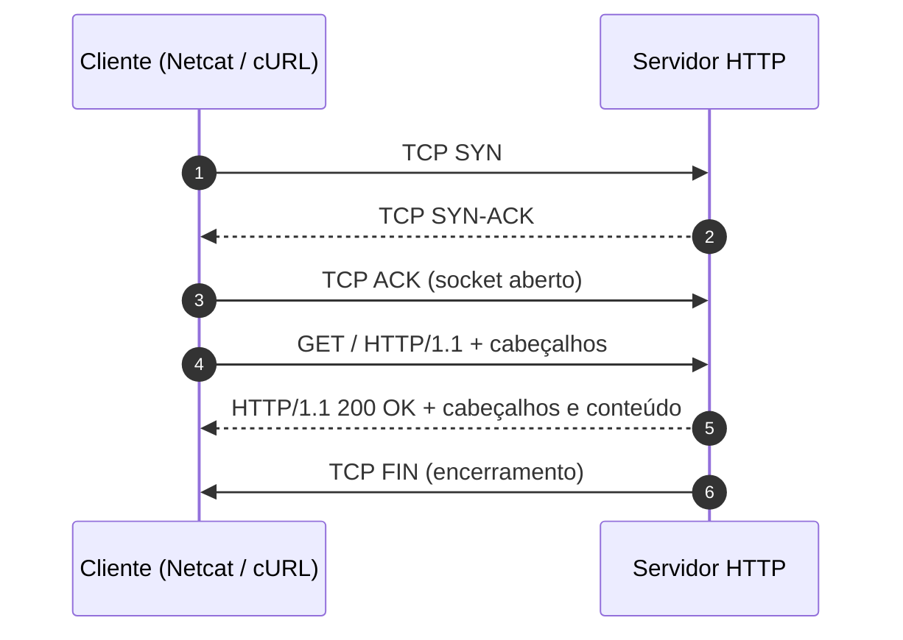

# Memória de Desenvolvimento — Semana 01

## Protocolo HTTP & Sockets Bare-Metal

**Aluno:** Jackson Machado de Azeredo  
**Matrícula:** 202421200110
**Curso:** Bacharelado em Sistemas de Informação

---

## 1. Mapeamento da Camada de Transporte

O TCP estabelece a conexão por meio das mensagens SYN, SYN-ACK e ACK. Depois, o cliente envia a requisição HTTP e o servidor responde. O diagrama é uma representação simplificada da comunicação.

## 2. Registro dos Experimentos de Laboratório

### Experimento 1: Netcat e erro 400 Bad Request

Ao enviar uma requisição HTTP/1.1 sem o cabeçalho `Host`, o servidor pode responder com `400 Bad Request`, indicando que a requisição está inválida ou incompleta. O campo `Host` informa o domínio solicitado e permite que o servidor identifique o site correto quando vários domínios compartilham o mesmo endereço IP.

### Experimento 2: Métodos HTTP

O método **GET** é usado para solicitar dados; **POST** envia dados ao servidor para processamento; e **OPTIONS** consulta quais métodos ou opções estão disponíveis. O cabeçalho `Content-Length` informa o tamanho do corpo da mensagem em bytes, ajudando o servidor a saber quanto conteúdo deve ler do socket.

### Experimento 3: URL, query strings e percent-encoding

No primeiro comando, os espaços reais na URL podem fazer o cURL rejeitar o endereço como inválido. No segundo, `%20` representa o espaço e sequências como `%C3%A7` representam caracteres acentuados em UTF-8. Essa codificação permite incluir espaços e caracteres especiais na URL sem comprometer sua estrutura.

### Experimento 4: Accept e User-Agent

O cabeçalho `Accept` informa quais formatos de conteúdo o cliente prefere receber, como JSON. O `User-Agent` identifica a aplicação cliente, por exemplo, o cURL ou um navegador. A resposta pode mudar conforme esses cabeçalhos, mas isso depende de como o servidor foi configurado.

### Experimento 5: Redirecionamento e cache

Com `curl -I`, o cURL mostra os cabeçalhos da resposta inicial, que pode ser um `301 Moved Permanently` com o endereço de destino no campo `Location`. Com `curl -I -L`, ele segue o redirecionamento e mostra também a resposta do destino final. Para o cache, o cliente envia a ETag anteriormente recebida usando `If-None-Match`; se o recurso não mudou, o servidor pode responder `304 Not Modified`, evitando reenviar o conteúdo.

## 3. Conclusão Técnica

Entender o HTTP e os sockets ajuda a compreender como clientes e servidores trocam informações em uma rede. Métodos, cabeçalhos e códigos de status permitem identificar o tipo de solicitação, interpretar a resposta e investigar problemas de comunicação.

Também é importante respeitar a estrutura das mensagens HTTP. Em HTTP/1.1, as linhas usam CRLF (`\r\n`) e a sequência `\r\n\r\n` indica o fim dos cabeçalhos. Como o socket transmite um fluxo de bytes, o programa precisa interpretar corretamente os limites e o tamanho das mensagens para evitar erros e transferências desnecessárias.
